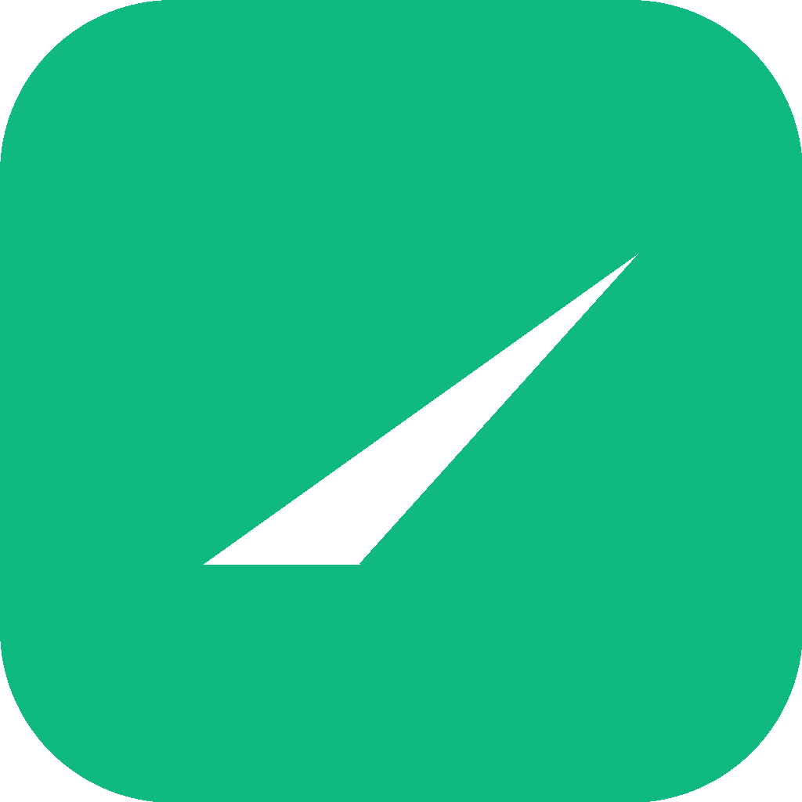
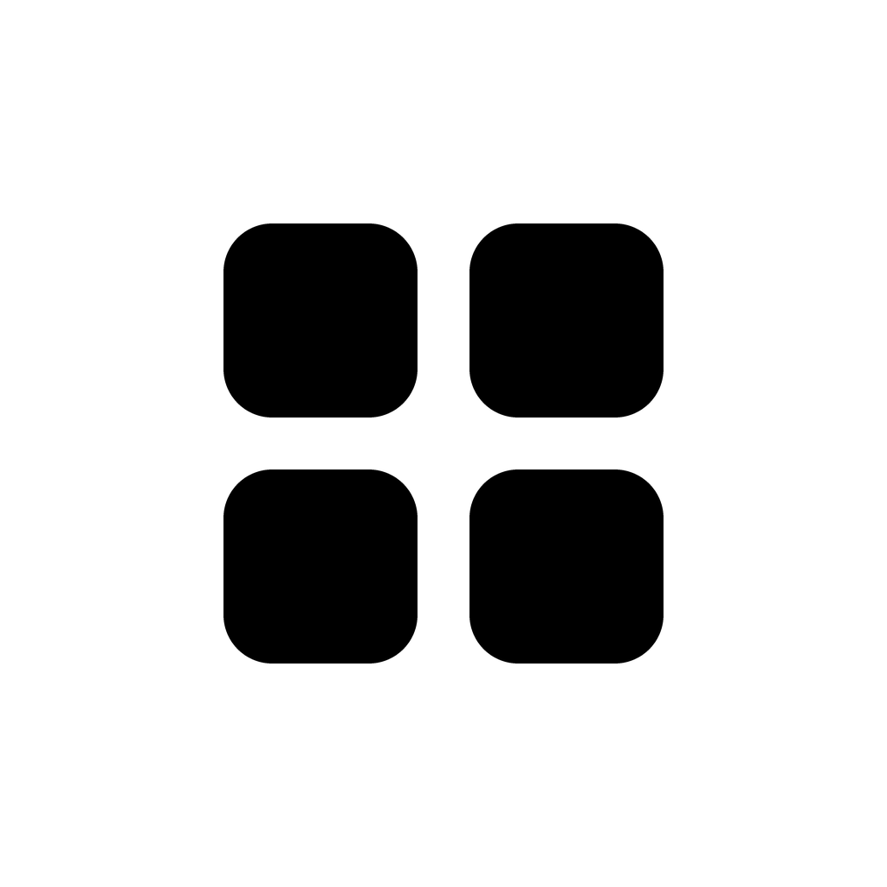
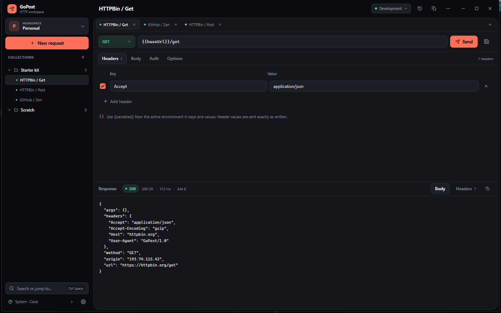
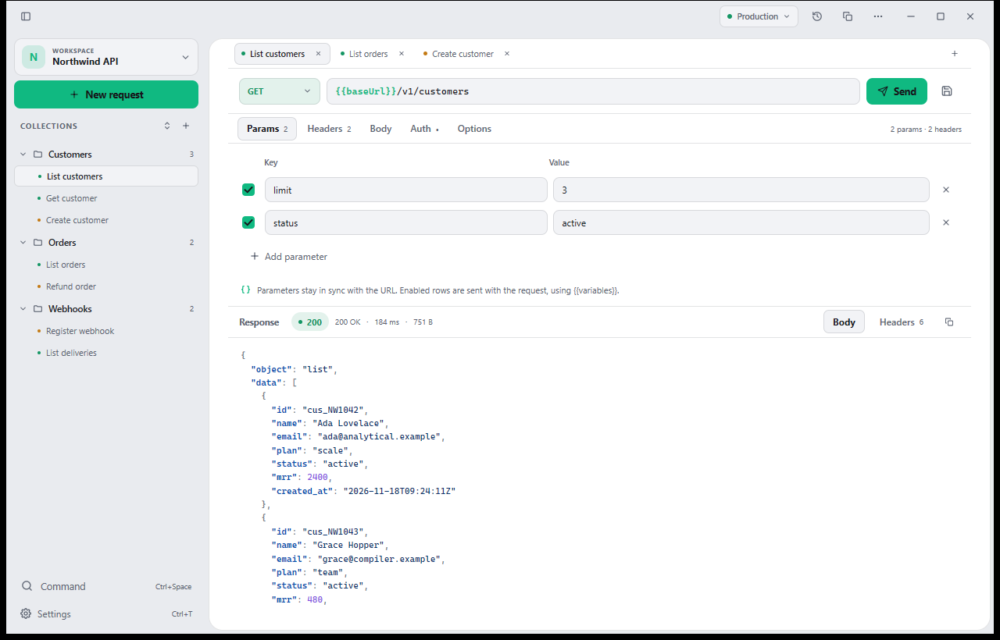
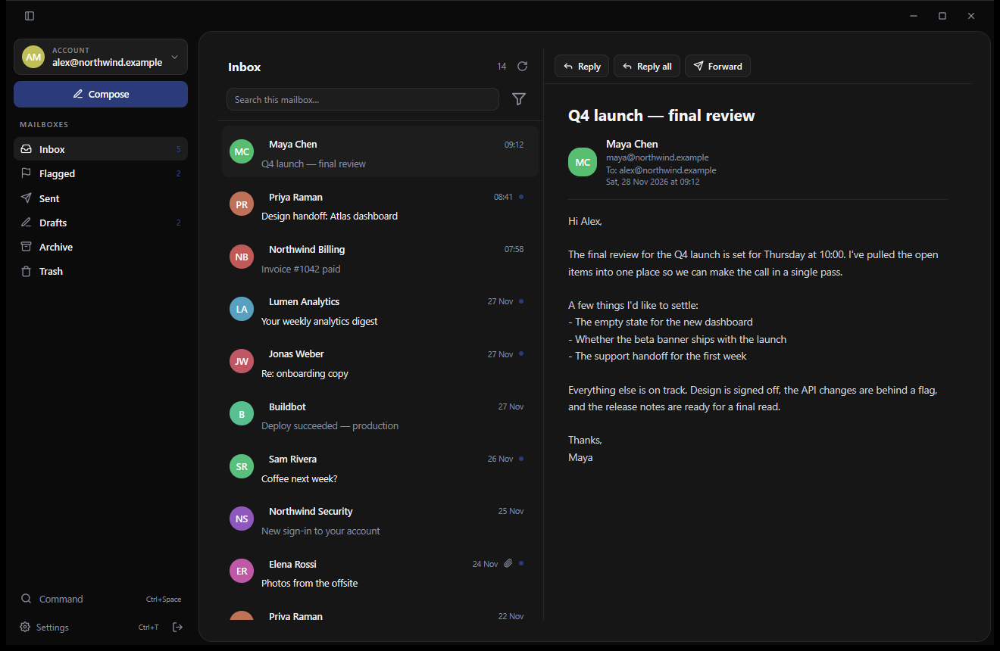
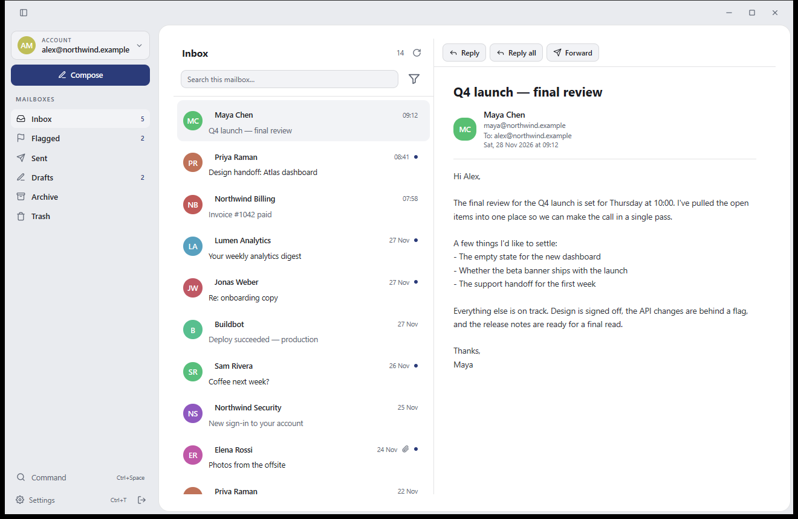
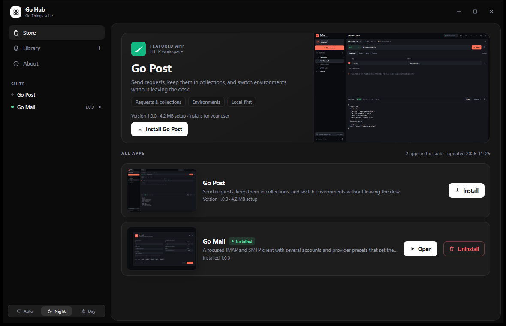
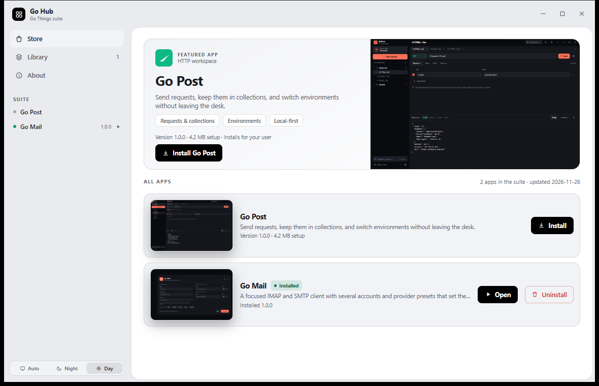

# Go Things

A small suite of Windows desktop apps built with [Go](https://go.dev) and
[MyGo](https://mygo.egoist.dev). Each app is independent, keeps its data on your
machine, and can be built from this repository.

| App | What it does |
|---|---|
|  **[Go Post](go-post/README.md)** | Send HTTP requests, organise them in collections, and switch between environments. |
|  **[Go Mail](go-mail/README.md)** | Read and send mail over IMAP/SMTP with several accounts and provider presets. |
|  **[Go Hub](go-hub/README.md)** | A store for the suite: install, update and launch the apps from a release catalog. |

## Download

[Download the latest Go Hub installer](https://github.com/BryanVanWinnendael/Go-Things/releases/latest/download/go-hub-setup-1.0.0-amd64.exe). The hub then installs and updates the other apps for you. See [all releases](https://github.com/BryanVanWinnendael/Go-Things/releases/latest) for earlier versions.

## Screenshots

Every app ships dark and light captures. Go Hub switches between them
automatically when you change theme.

| App | Night | Day |
|---|---|---|
| Go Post |  |  |
| Go Mail |  |  |
| Go Hub |  |  |

## Build everything

Requires Go 1.27+ on Windows. From the repository root:

```powershell
.\build.ps1
```

This clears each app's old `build/` folder, builds every app, and leaves
the Windows installers in `<app>/build/windows-amd64/`. Build output is ignored
by Git. To build one app, run this from its folder:

```powershell
go run github.com/egoist/mygo/cmd/mygo build -platform windows/amd64
```

## Where things live

- `catalog.json` — the store catalog published in a GitHub release.
- `RELEASING.md` — how to publish installers, pictures and a new catalog.
- `STRUCTURE.md` — the shared `cmd/` + `internal/` + `resources/` layout.

Installed copies of Go Hub read the catalog from the latest GitHub release, not
from this working tree. See [RELEASING.md](RELEASING.md) before expecting a
catalog change to show up in an installed hub.
