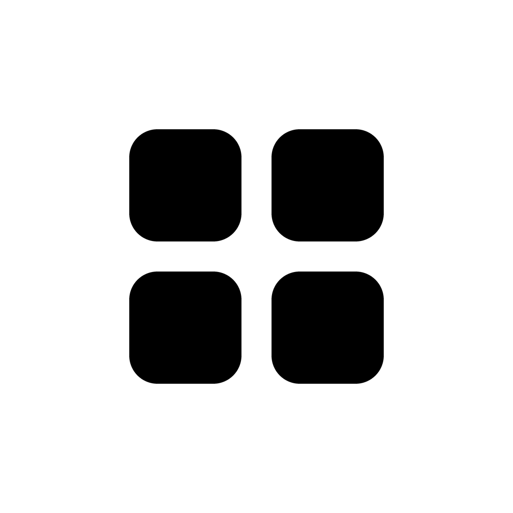
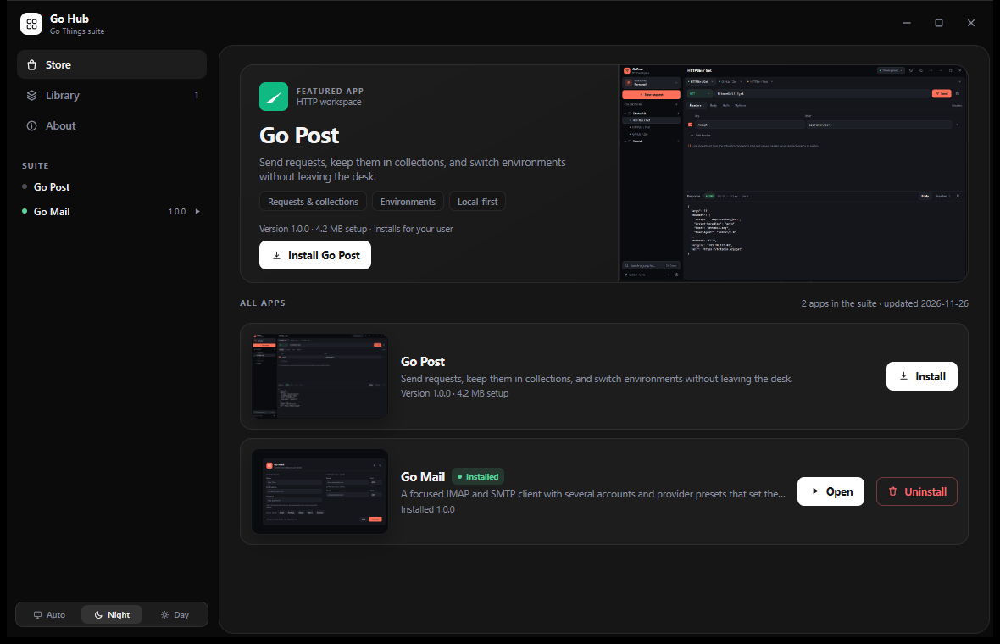
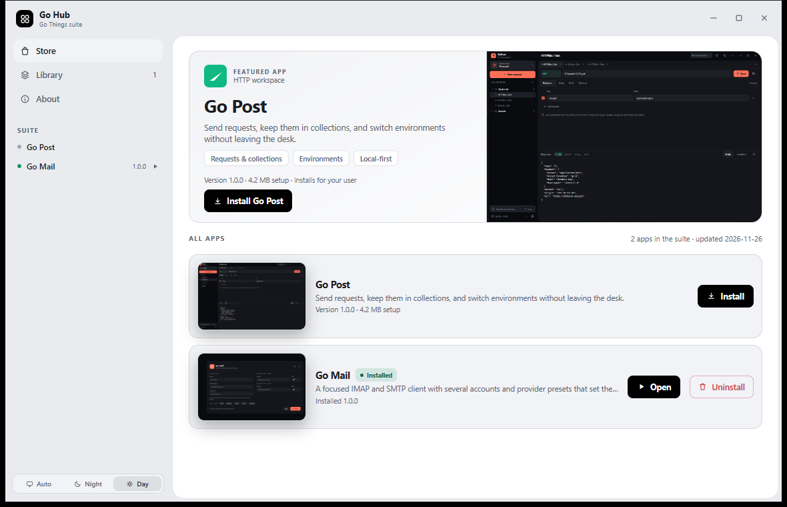
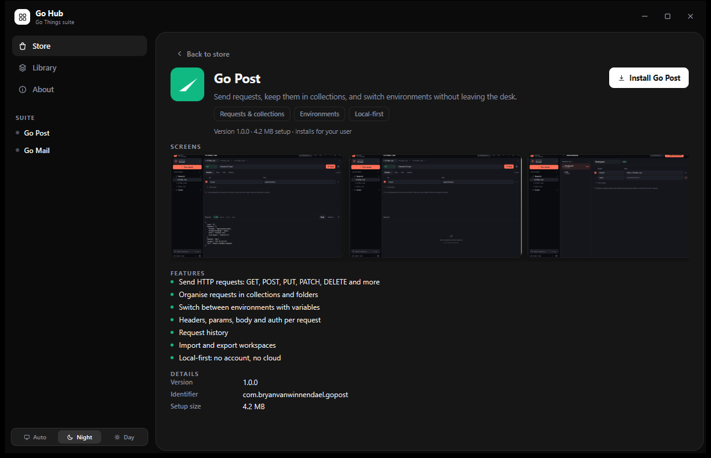
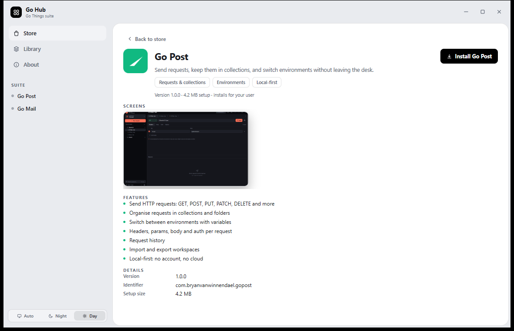
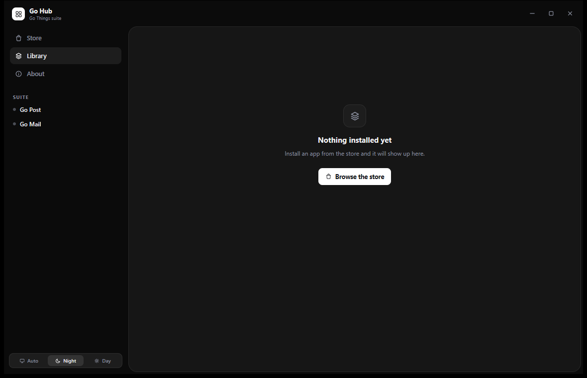
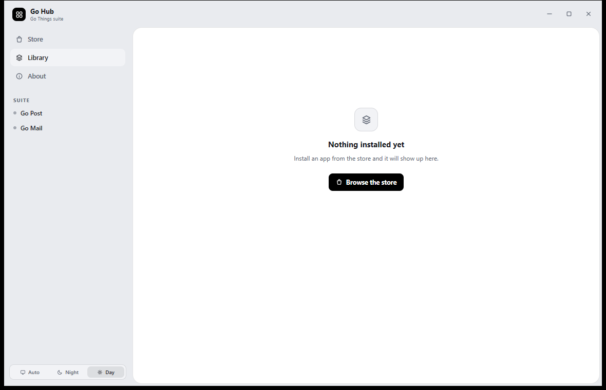

# Go Hub

<p align="left"></p>

The storefront for the Go Things suite. It shows what each app does, installs or
updates it from the newest GitHub release, and keeps a small library of what is
installed on this PC.

## Features

- Catalog-driven store: featured app, suite list, version and setup size
- Install, update, uninstall, open and "show installed folder" actions
- Checks its own version against the catalog and offers a Go Hub update
- Detail pages with real screenshots, feature lists and install facts
- Library of installed apps, driven by the Windows per-user uninstall keys
- Auto / Night / Day theme switch; store pictures switch with the theme
- Go Post and Go Mail each have their own theme editor — palettes, custom themes and window material — so their look is set inside those apps, not here
- Background catalog check with a Retry banner when GitHub cannot be reached
- `Ctrl+R` to refresh the catalog and installed state together

## Screenshots

| Screen | Night | Day |
|---|---|---|
| Store |  |  |
| App detail |  |  |
| Library |  |  |

## Build and run

From this folder, with Go 1.27+ on Windows:

```powershell
go run github.com/egoist/mygo/cmd/mygo build -platform windows/amd64
.\build\windows-amd64\go-hub.exe
```

`..\build.ps1` builds every suite app at once. Use `gofmt -w .`,
`go vet ./...` and `go test ./...` for the usual checks.

## How updates work

Go Hub does **not** bundle the other apps' installers or pictures. It reads:

```
https://github.com/BryanVanWinnendael/Go-Things/releases/latest/download/catalog.json
```

and downloads setups from the URLs in that file into
`%LOCALAPPDATA%\go-hub\downloads\`, checking that each download really is a
Windows executable before running it. Pictures come straight from the
repository, so a `preview-lightN.png` only appears in the store after it has
been committed and the catalog has been attached to a release. See
[../RELEASING.md](../RELEASING.md).

If the catalog cannot be fetched, the hub still works from a built-in copy.
That copy was compiled into the binary, so rebuilding Go Hub is needed to
change it.

## Where data lives

The theme choice is in `%APPDATA%\go-hub\settings.json`. Downloaded installers
are cached under `%LOCALAPPDATA%\go-hub\downloads\`.

## Layout

`main` in `mygo.json` points at `cmd/go-hub`. `internal/app` holds the window
and pages; `internal/catalog` fetches and validates the catalog;
`internal/install` talks to Windows; `internal/settings` and `internal/theme`
handle preferences and palettes. See [../STRUCTURE.md](../STRUCTURE.md).
