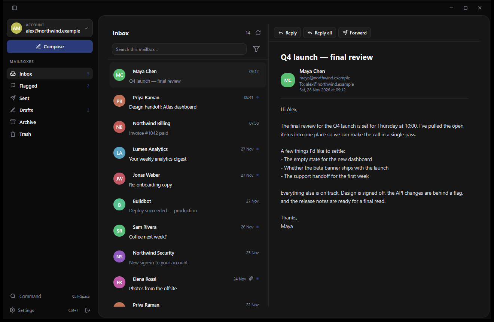
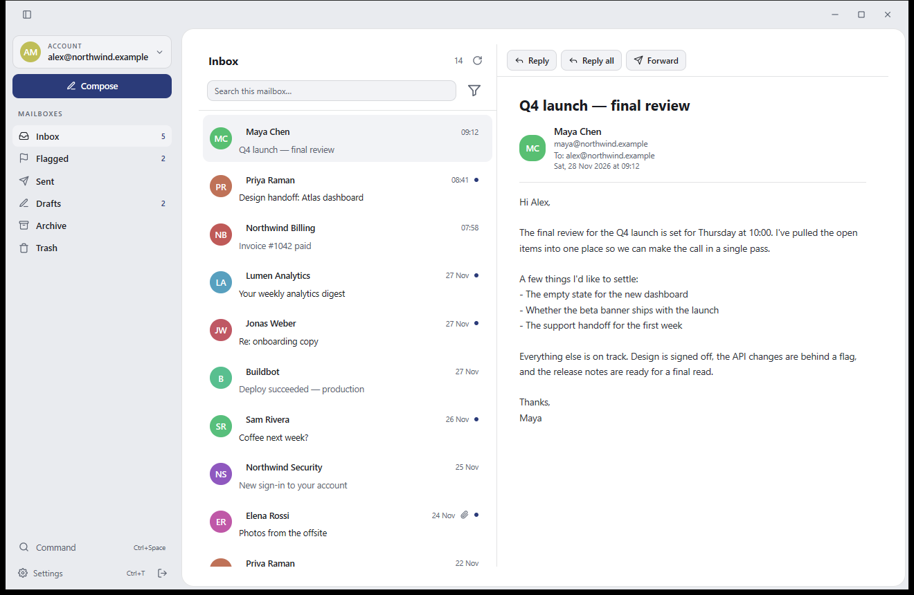
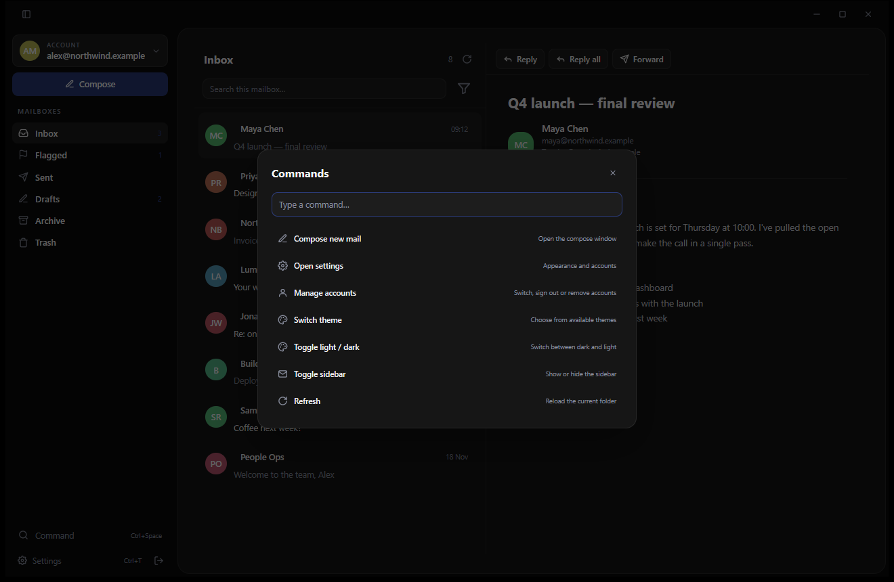
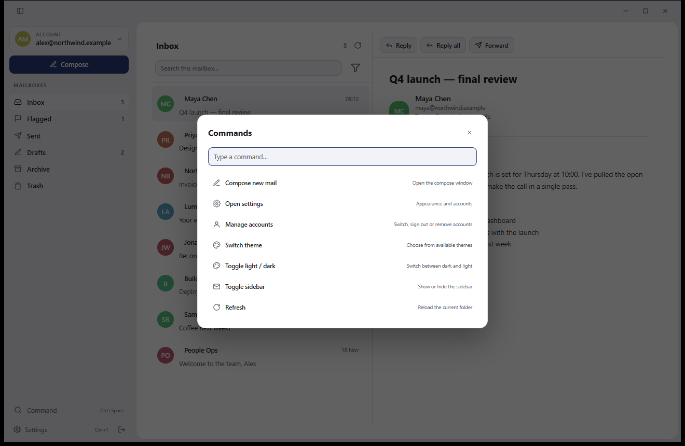
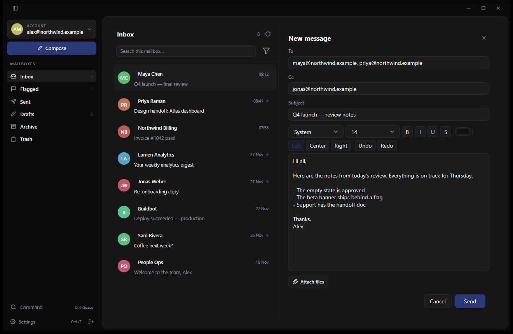
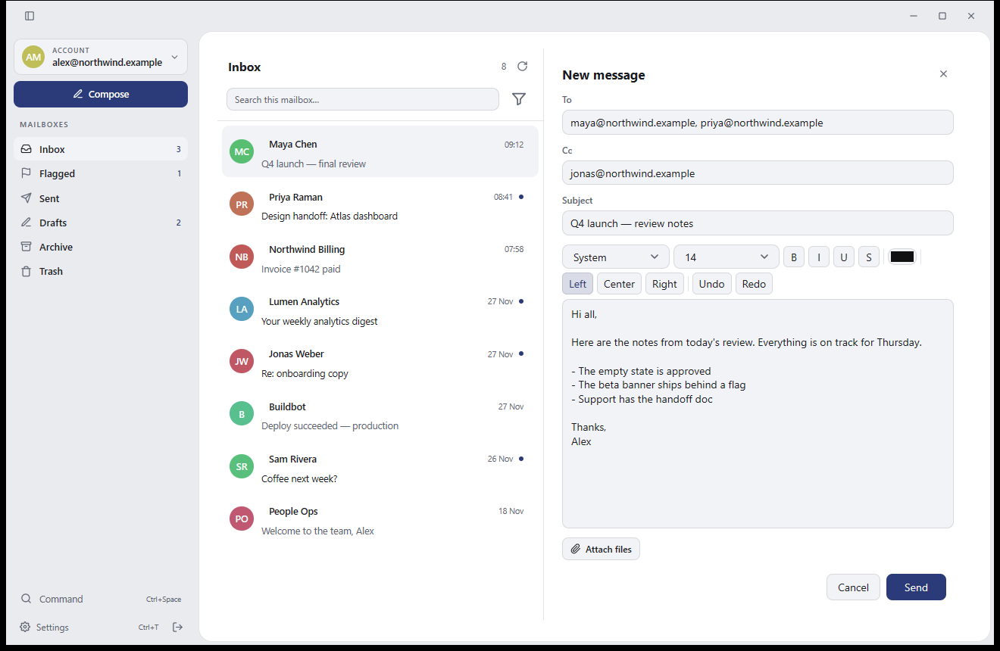

# Go Mail

<p align="left"></p>

A focused IMAP and SMTP client for Windows. Bring several accounts, let the
provider presets fill in the server details, and read mail in a clean split-pane
window. Everything stays on your machine.

## Features

- IMAP reading and SMTP sending, with app-password guidance for big providers
- Presets for Gmail, Outlook, iCloud, Yahoo and Fastmail
- Several accounts in one window, with a switcher in the sidebar
- Mailboxes with unread counts, drag-to-reorder, plus Flagged and Shared views
- Search, filters, attachments, and a background message cache
- Compose with a rich-text toolbar, signatures and signature images
- Customise the theme and look: Dark, Light, System and extra palettes, or your own themes with tinted window chrome, a stage colour and a gradient background; window material is per account
- Command palette for composing, settings, accounts and themes

## Screenshots

| Screen | Night | Day |
|---|---|---|
| Inbox and reading pane |  |  |
| Command palette |  |  |
| Compose |  |  |

## Build and run

From this folder, with Go 1.27+ on Windows:

```powershell
go run github.com/egoist/mygo/cmd/mygo build -platform windows/amd64
.\build\windows-amd64\go-mail.exe
```

`..\build.ps1` builds every suite app at once. Use `gofmt -w .`,
`go vet ./...` and `go test ./...` for the usual checks.

## Where data lives

Accounts and settings are in `%APPDATA%\Go Mail\config.json` (passwords are
encrypted there, never stored in plain text). Fetched messages are cached in
`cache.json` beside it, and sender logos in `logos\`. For tests or a separate
identity, point the app elsewhere:

```powershell
$env:GO_MAIL_CONFIG = "C:\temp\mail\config.json"
$env:GO_MAIL_CACHE  = "C:\temp\mail\cache.json"
$env:GO_MAIL_LOGOS  = "C:\temp\mail\logos"
```

## Shortcuts

| Keys | Action |
|---|---|
| `Ctrl+Space` | Command palette |
| `Ctrl+T` | Settings |
| `Ctrl+S` | Show/hide the sidebar |

## Layout

`main` in `mygo.json` points at `cmd/go-mail`. UI and app state live in
`internal/app`; the IMAP/SMTP engine, message building and signatures live in
`internal/mail`. The root `manifest.go` embeds `mygo.json` so the version shown
in the UI matches the installer. See [../STRUCTURE.md](../STRUCTURE.md).
