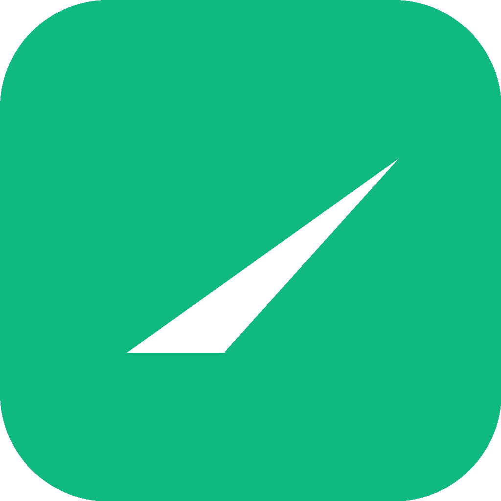
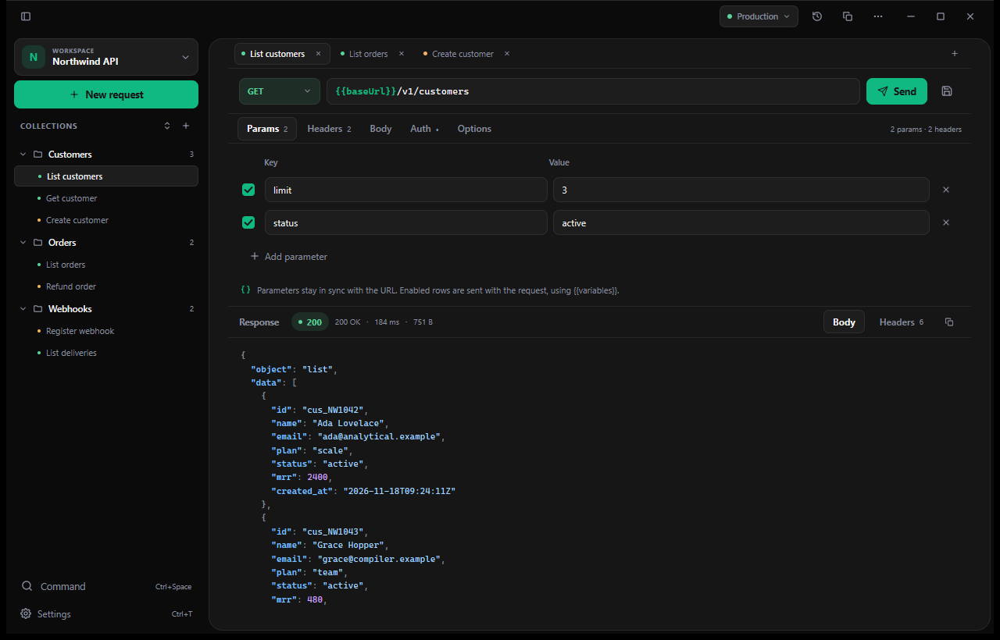
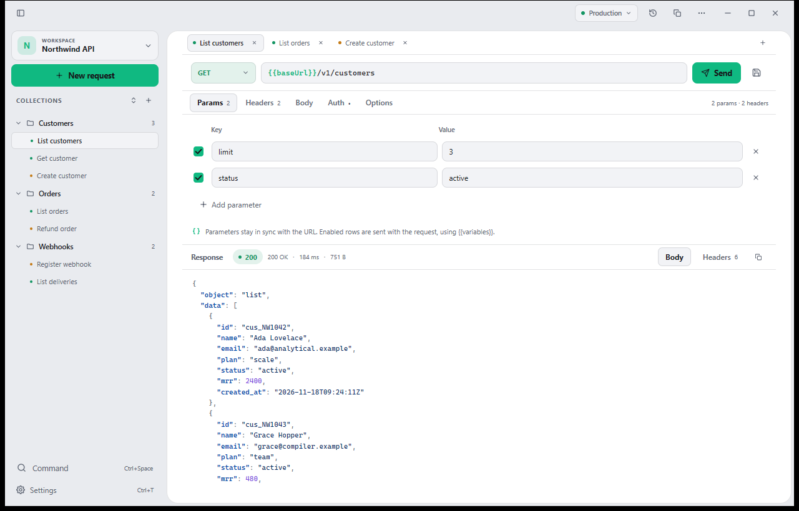
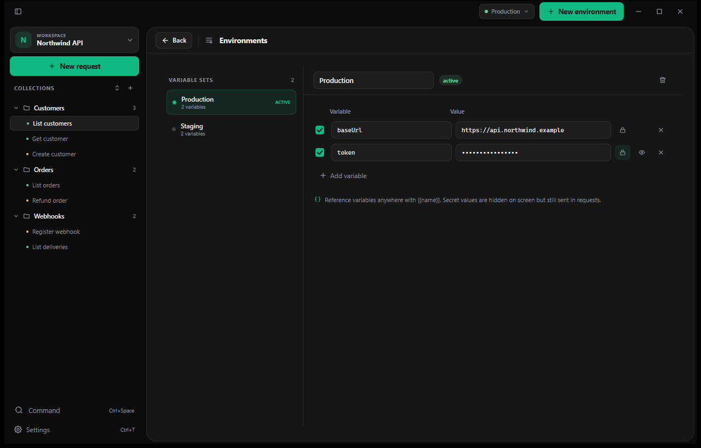
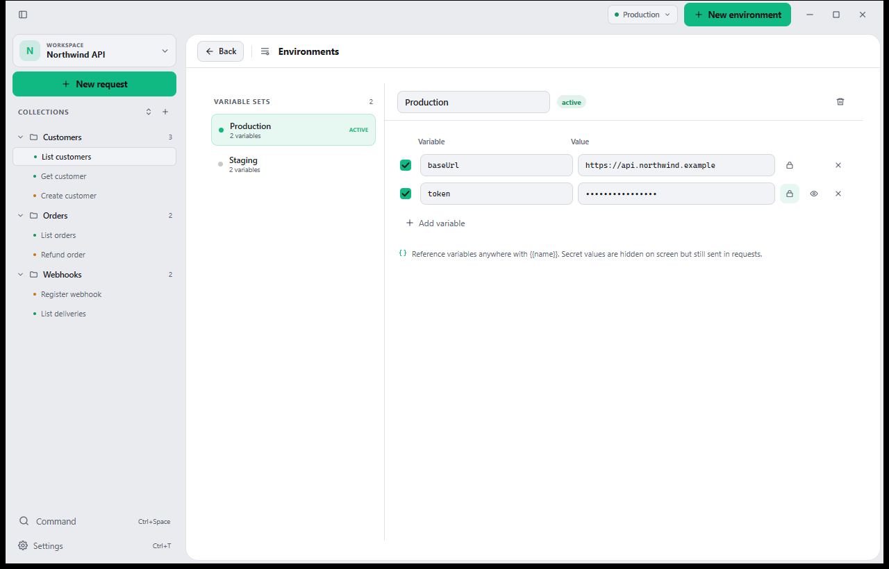
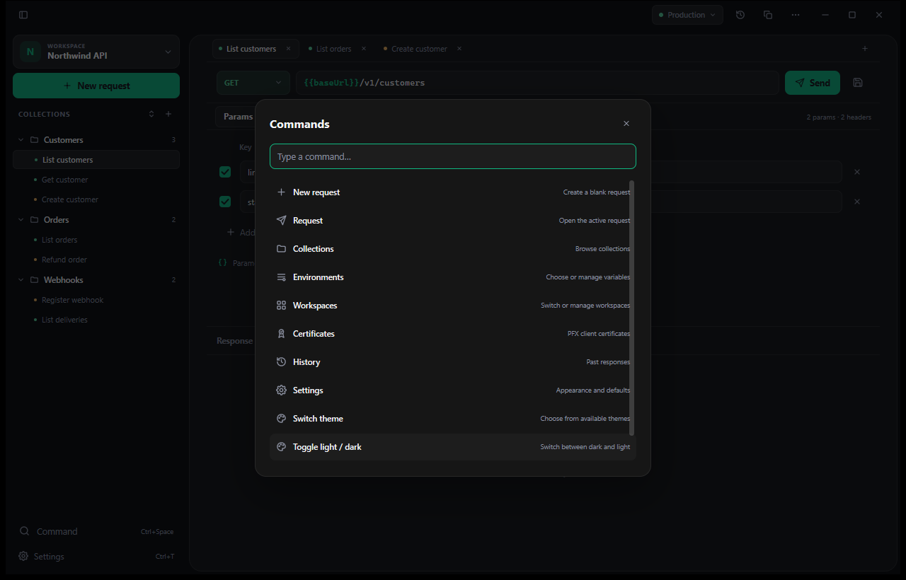
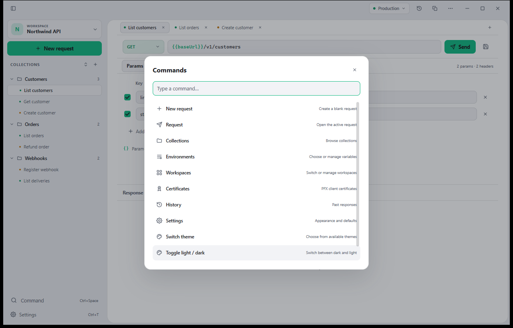

# Go Post

<p align="left"></p>

A local-first HTTP workspace. Send requests, keep them in collections, and move
between environments without leaving the desk. No account, no cloud.

## Features

- GET, POST, PUT, PATCH, DELETE and other HTTP methods
- Collections and folders for requests, with bearer/basic authorization
- Environments with variables; secret values are masked on screen
- Headers, query params, body types (JSON, text, XML) and per-request auth
- Client-certificate support and request history
- Import/export of workspaces, including cURL commands
- Command palette for jumping to any page or action
- Nocturne and Daylight themes, plus custom themes

## Screenshots

| Screen | Night | Day |
|---|---|---|
| Request and response |  |  |
| Environment manager |  |  |
| Command palette |  |  |

## Build and run

From this folder, with Go 1.27+ on Windows:

```powershell
go run github.com/egoist/mygo/cmd/mygo build -platform windows/amd64
.\build\windows-amd64\go-post.exe
```

`..\build.ps1` builds every suite app at once. Use `gofmt -w .`,
`go vet ./...` and `go test ./...` for the usual checks.

## Where data lives

Go Post keeps its workspaces in `%APPDATA%\Go Post\gopost.json`, with client
certificates in the `certificates\` folder beside it. The app rewrites that file
when you make a change; deleting it starts you with the built-in starter kit.

## Shortcuts

| Keys | Action |
|---|---|
| `Ctrl+Space` | Command palette |
| `Ctrl+Enter` | Send the active request |
| `Ctrl+1` / `Ctrl+2` / `Ctrl+3` | Request / Collections / Environments |
| `Ctrl+4` / `Ctrl+5` / `Ctrl+6` | Certificates / History / Workspaces |
| `Ctrl+,` | Settings |

## Layout

`main` in `mygo.json` points at `cmd/go-post`. UI and app state live in
`internal/app`; the model, store, HTTP client, auth, certificates and query
helpers live in `internal/core`. See [../STRUCTURE.md](../STRUCTURE.md).
